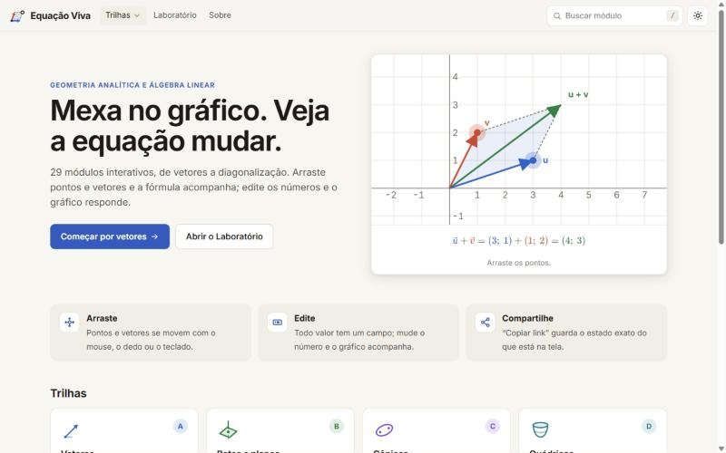
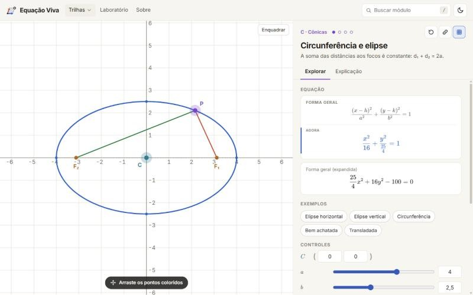
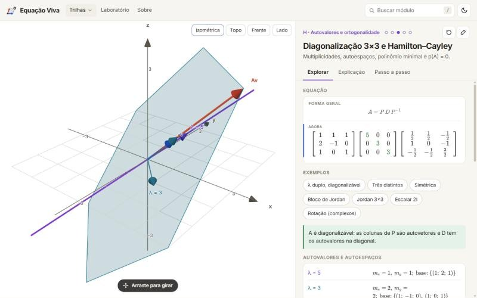
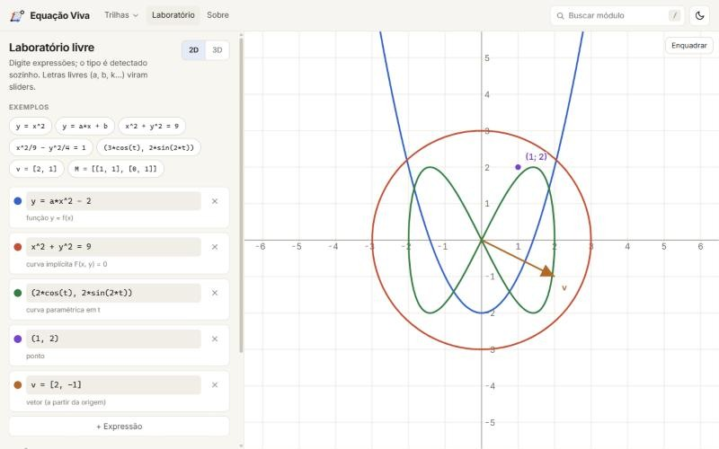

<div align="center">

<picture>
  <source media="(prefers-color-scheme: dark)" srcset="docs/logo-escuro.svg">
  
</picture>

# Equação Viva

**Geometria Analítica e Álgebra Linear com gráficos interativos.**<br>
Mexa no gráfico e veja a equação mudar; edite a equação e veja o gráfico responder.

[](https://falow1.github.io/equacao-viva/)
[](https://github.com/Falow1/equacao-viva/actions/workflows/deploy.yml)


### [Abrir o site](https://falow1.github.io/equacao-viva/)



</div>

## Sumário

- [Sobre](#sobre)
- [Funcionalidades](#funcionalidades)
- [Conteúdo](#conteúdo)
- [Capturas de tela](#capturas-de-tela)
- [Como rodar](#como-rodar)
- [Publicação](#publicação)
- [Estrutura do projeto](#estrutura-do-projeto)
- [Convenções](#convenções)
- [Tecnologias](#tecnologias)
- [Créditos](#créditos)

## Sobre

O **Equação Viva** é um site para estudar a disciplina de Geometria Analítica e Álgebra Linear vendo cada equação ao lado do seu gráfico. A
ligação vale nos dois sentidos: arrastar um ponto muda os números da fórmula, e editar um número move o desenho.

São **29 módulos** organizados em **8 trilhas**, de vetores a diagonalização, mais um **laboratório livre** onde se digita qualquer expressão.
Tudo roda no navegador, sem servidor, login ou coleta de dados.

## Funcionalidades

- **Equação viva** — a forma geral e a forma com os valores atuais aparecem juntas e mudam enquanto você mexe no gráfico.
- **Mesma cor no gráfico e na fórmula** — cada objeto (vetor, reta, foco, autoespaço) tem uma cor que se repete na equação.
- **2D e 3D** — planos cartesianos com zoom e arraste; cenas 3D com eixo z para cima, rotação e vistas prontas (isométrica, topo, frente, lado).
- **Explicação e passo a passo** — cada módulo tem abas com a teoria e, quando faz sentido, as contas detalhadas (escalonamento, Gram–Schmidt,
  polinômio característico...).
- **Exemplos de um clique** — casos especiais prontos, como retas paralelas, matriz não diagonalizável ou cônica degenerada.
- **Link do estado** — "Copiar link" guarda exatamente o que está na tela; quem abrir o link vê o mesmo gráfico.
- **Laboratório livre** — funções, curvas implícitas e paramétricas, pontos, vetores, matrizes e superfícies, com detecção automática do tipo.
  Letras livres viram sliders.
- **Tema claro e escuro**, layout para celular, navegação por teclado e busca de módulos (atalho <kbd>/</kbd> ou <kbd>Ctrl</kbd>+<kbd>K</kbd>).

## Conteúdo

| Trilha | Módulos |
| --- | --- |
| **A · Vetores** | A1 Vetores no plano · A2 Produto escalar, ângulo e projeção · A3 Produto vetorial e misto (3D) |
| **B · Retas e planos** | B1 Equações da reta no plano · B2 Duas retas e um ponto · B3 Reta no espaço · B4 Plano no espaço · B5 Posições relativas e distâncias |
| **C · Cônicas** | C1 Circunferência e elipse · C2 Hipérbole · C3 Parábola · C4 Equação geral do 2º grau (rotação e translação) |
| **D · Quádricas** | D1 Galeria das quádricas |
| **E · Sistemas lineares e matrizes** | E1 Sistemas lineares: o que é a solução · E2 Eliminação de Gauss passo a passo · E3 Determinante como área e volume · E4 Operações com matrizes e inversa |
| **F · Espaços vetoriais** | F1 Combinação linear e espaço gerado · F2 Subespaços, base e dimensão · F3 Base e mudança de base · F4 Núcleo, imagem e posto |
| **G · Transformações lineares** | G1 Matriz como transformação do plano · G2 Composição e inversa · G3 Transformações no espaço |
| **H · Autovalores e ortogonalidade** | H1 Autovalores e autovetores · H2 Diagonalização e formas quadráticas · H3 Diagonalização 3×3 e Hamilton–Cayley · H4 Projeção ortogonal e Gram–Schmidt · H5 Mínimos quadrados |

## Capturas de tela

<table>
  <tr>
    <td width="50%"></td>
    <td width="50%"></td>
  </tr>
  <tr>
    <td align="center"><sub>Módulo 2D: elipse, focos e a equação reduzida</sub></td>
    <td align="center"><sub>Módulo 3D: autoespaços e A = PDP⁻¹</sub></td>
  </tr>
  <tr>
    <td colspan="2"></td>
  </tr>
  <tr>
    <td colspan="2" align="center"><sub>Laboratório livre: digite expressões e veja tudo no mesmo gráfico</sub></td>
  </tr>
</table>

## Como rodar

### Pré-requisitos

- [Node.js](https://nodejs.org) 20.19 ou mais novo (recomendado: 22 LTS)

### Instalação

```bash
git clone https://github.com/Falow1/equacao-viva.git
```

```bash
cd equacao-viva
```

```bash
npm install
```

```bash
npm run dev
```

Abra o endereço que aparecer no terminal (normalmente http://localhost:5173).

### Scripts

| Comando | O que faz |
| --- | --- |
| `npm run dev` | Servidor de desenvolvimento com recarga automática |
| `npm test` | Testes do núcleo matemático (cônicas, sistemas, escalonamento, posições no espaço, autovalores...) |
| `npm run typecheck` | Verificação de tipos do TypeScript |
| `npm run build` | Gera o site estático em `dist/` |
| `npm run preview` | Serve a pasta `dist/` para conferir o build |

## Publicação

O site é publicado no **GitHub Pages** automaticamente a cada push na branch `main`, pelo fluxo
[`.github/workflows/deploy.yml`](.github/workflows/deploy.yml): ele instala as dependências, roda os testes, gera o build e publica a pasta `dist/`.

O build usa caminhos relativos (`base: "./"`) e rotas com `#`, então também funciona em qualquer outra hospedagem de arquivos estáticos,
inclusive dentro de uma subpasta, sem configuração de servidor.

## Estrutura do projeto

```text
src/
├── math/        núcleo matemático puro: vetores, matrizes, sistemas, cônicas, quádricas, autovalores, formatação pt-BR
├── viz2d/       componentes de gráfico 2D (sobre o Mafs)
├── viz3d/       cena 3D (Three.js + React Three Fiber), com eixo z para cima
├── modules/     um arquivo por módulo (A1.tsx … H5.tsx) e o registro das trilhas em registry.ts
├── pages/       início, trilha, módulo, laboratório, sobre e página não encontrada
├── ui/          cabeçalho, rodapé, logo, ícones, controles, equação viva e layout dos módulos
├── styles/      tokens (cores e medidas), base, componentes, páginas, módulo e laboratório
├── state/       estado sincronizado com a URL
└── credits.ts   créditos do trabalho (rodapé e página Sobre)
tests/           testes do núcleo matemático (Vitest)
docs/            logo e capturas de tela deste README
```

Para mudar os créditos (curso, professor, autores, período), edite [`src/credits.ts`](src/credits.ts); campos vazios não aparecem no site.

## Convenções

- Vírgula como separador decimal e coordenadas separadas por ponto e vírgula: `(2; −1)`.
- Frações quando o número é uma fração simples; os demais com até duas casas decimais.
- No espaço, o eixo z aponta para cima.

## Tecnologias

| | |
| --- | --- |
| Interface | [React](https://react.dev) 19 · [TypeScript](https://www.typescriptlang.org) · [Vite](https://vite.dev) · [React Router](https://reactrouter.com) |
| Gráficos 2D | [Mafs](https://mafs.dev) |
| Gráficos 3D | [Three.js](https://threejs.org) · [React Three Fiber](https://r3f.docs.pmnd.rs) · [drei](https://drei.docs.pmnd.rs) |
| Fórmulas | [KaTeX](https://katex.org) |
| Laboratório | [math.js](https://mathjs.org) |
| Fonte | [Inter](https://rsms.me/inter/) |
| Testes | [Vitest](https://vitest.dev) |

## Créditos

Trabalho da disciplina de **Geometria Analítica e Álgebra Linear** · UNEMAT.

Feito por [@Falow1](https://github.com/Falow1).
